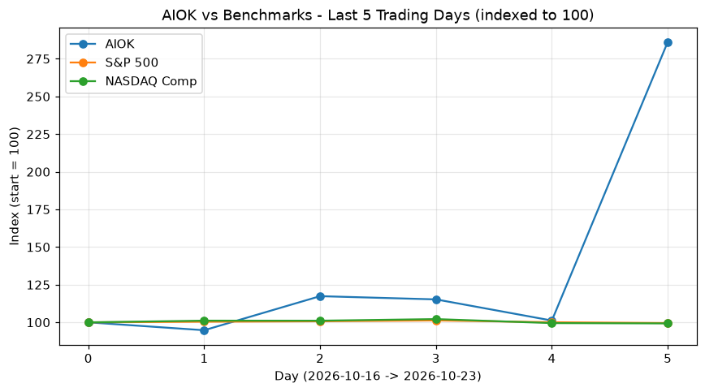
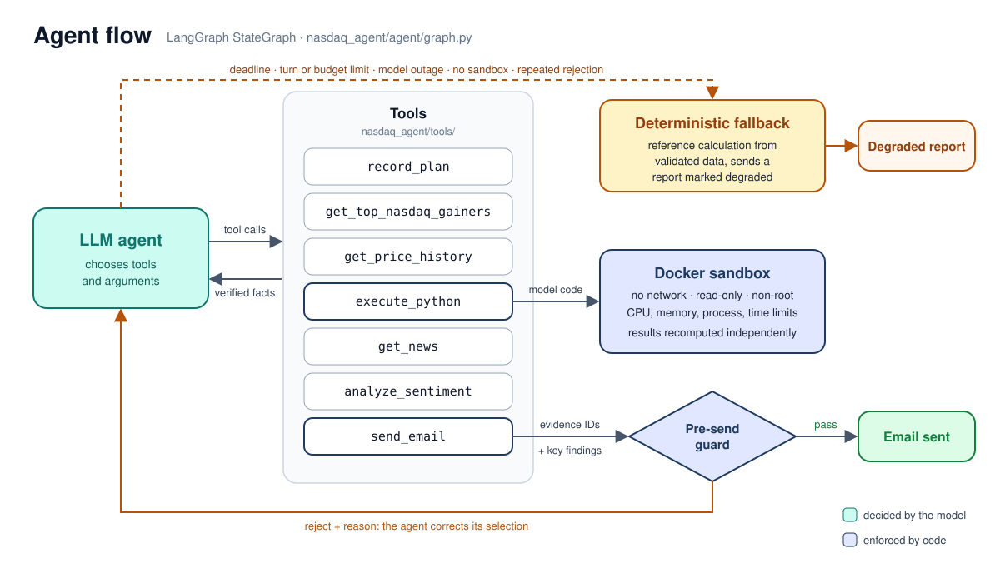
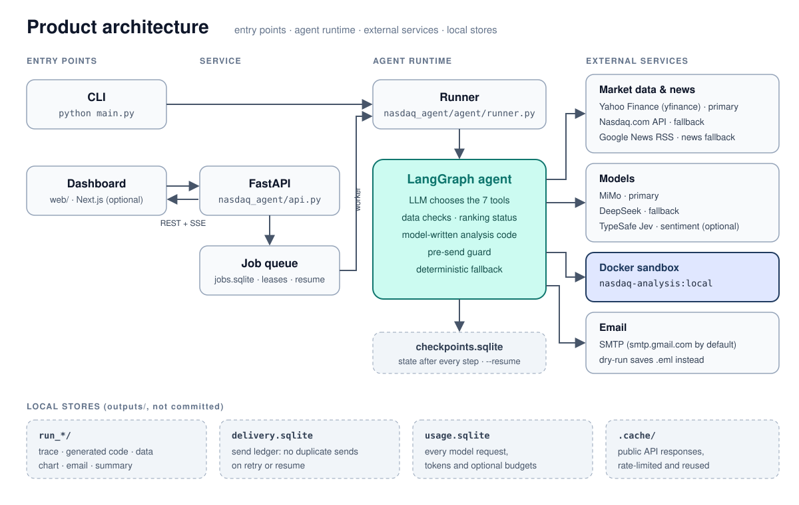
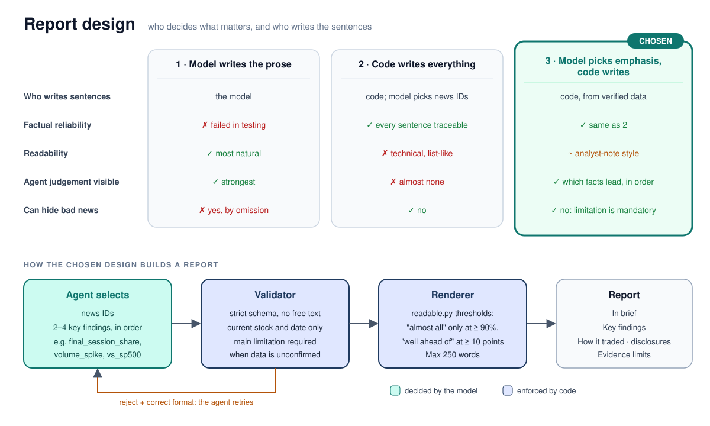

<div align="center">

# NASDAQ Top-Gainer Agent

**An autonomous LangGraph agent that finds the day's top NASDAQ gainer, writes and runs its own analysis code, and emails a report whose every number is independently recomputed.**

<p>
  
  
  
  
</p>

<p>
  <b>English</b> · <a href="README.zh-TW.md">繁體中文</a>
</p>

<p>
  <a href="#review-in-five-minutes">Quick review</a> ·
  <a href="#how-it-works">How it works</a> ·
  <a href="#product-architecture">Architecture</a> ·
  <a href="#how-the-report-is-written">Report design</a> ·
  <a href="#data-checks-and-ranking-status">Data checks</a> ·
  <a href="#setup">Setup</a> ·
  <a href="#run">Run</a> ·
  <a href="#tests-and-evaluations">Tests</a>
</p>


<br><sub>Chart drawn by the agent's own code for AIOK, the top filtered gainer on 23 Oct 2026.</sub>

</div>

---

## Review in five minutes

<table>
<tr><td width="170"><b>What it does</b></td><td>One LangGraph agent with seven tools: plan, screen gainers, fetch prices and news, write and run analysis code, score headline sentiment, send email. The model chooses the order and arguments; code verifies every number and controls the email. Full design: <a href="REPORT.md">REPORT.md</a>.</td></tr>
<tr><td><b>Where to look</b></td><td><a href="nasdaq_agent/agent/graph.py"><code>graph.py</code></a> agent loop, guard, fallback<br><a href="nasdaq_agent/tools/gainers.py"><code>gainers.py</code></a> + <a href="nasdaq_agent/data/ranking.py"><code>ranking.py</code></a> screening and ranking status<br><a href="nasdaq_agent/tools/code_exec.py"><code>code_exec.py</code></a> + <a href="nasdaq_agent/sandbox/runner.py"><code>sandbox/runner.py</code></a> model-written code<br><a href="nasdaq_agent/reporting/evidence_report.py"><code>evidence_report.py</code></a> + <a href="nasdaq_agent/reporting/readable.py"><code>readable.py</code></a> report body</td></tr>
<tr><td><b>What a report claims</b></td><td>It names the <i>top verified candidate</i> and states a ranking status. "Verified" means no screener row that could rank higher is unresolved; it is not a guarantee against upstream data errors. A second vendor agreeing on the price supports the price, not the rank.</td></tr>
</table>

```powershell
uv sync --extra jev
docker build -t nasdaq-analysis:local -f nasdaq_agent/sandbox/Dockerfile .
uv run python main.py          # dry-run: the email is saved, not sent
```

> [!NOTE]
> Without Docker the run still finishes: the generated code is not executed, and the email is a degraded report computed by the fixed reference implementation.

## How it works

<p align="center"></p>

| Tool | Role |
|---|---|
| `record_plan` | Record or revise the plan (audited, not enforced) |
| `get_top_nasdaq_gainers` | Yahoo screener, Nasdaq.com fallback; dated, flagged candidates, the raw #1 and a ranking status |
| `get_price_history` | Validated stock and index closes, saved as datasets the code can load |
| `execute_python` | Runs model-written code in a Docker sandbox and recomputes every result independently |
| `get_news` / `analyze_sentiment` | ID-tagged headlines; sentiment labelled as a model estimate |
| `send_email` | Takes evidence IDs and 2–4 ordered key findings; code writes and sends the report |

### Product architecture

<p align="center"></p>

## How the report is written

<p align="center"></p>

The model decides **what matters**; code writes **every sentence** from verified data. A report opens with a one-line summary and the agent's key findings, for example:

> **In brief.** AIOK jumped 183% on Oct 23, with volume about 880 times its recent average.
>
> **Key findings.**
> 1. Almost all of the 5-session gain came on Oct 23, when the stock rose 183%; the 4 earlier sessions together added 1.2%.
> 2. Oct 23 volume was about 880 times the previous 5-session average of 48.6K shares a day — an extreme spike in trading.
> 3. GlobeNewswire published the headline: "AI OKTO Corp. Declares Special Dividend of $3.50 Per Share".
> 4. Over the same dates the S&P 500 fell 0.47% and the NASDAQ Composite fell 0.71%; AIOK's 186% 5-session gain was much larger than either index's move.

Wording follows fixed thresholds on the numbers ("almost all" only for a final-session share of 90% or more, "well ahead of" only for a gap of ten points or more). Facts that are not featured stay in the body, and when the ranking, filter eligibility or price check is unconfirmed the main limitation must be one of the findings. Contract details: [docs/evidence-report.md](docs/evidence-report.md).

### Why this design: three approaches compared

| | 1. Model writes the prose | 2. Code writes everything | **3. Chosen: model picks emphasis, code writes** |
|---|---|---|---|
| Model's role | Writes all text | Picks news IDs only | Picks news and 2–4 ordered key findings (which also lead the summary line) |
| Factual reliability | ❌ Failed in testing | ✅ Every sentence traceable to data | ✅ Same as 2 |
| Readability | ✅ Most natural | ❌ Technical, list-like | ⚠️ Analyst-note style, limited phrasing |
| Agent judgement visible | ✅ Strongest | ❌ Almost none | ✅ Which facts matter, and in what order |
| Can hide bad news | Yes, by omission | No | No: unfeatured facts stay; main limitation is mandatory |
| Pre-send check | Another model judges support; uncertain | Deterministic rules | Deterministic rules plus finding checks |
| Validation cost | High (blind review, human audit) | Low (unit tests) | Low to medium (unit tests plus a few live runs) |

| Evidence | Result |
|---|---|
| 1. Model writes the prose | Two of three audited accepted reports contained unsupported claims (an "entire gain" that was not, a guessed motive); only 12 of 24 blind reports could be judged reliably, so acceptance failed |
| 2. Code writes everything | Both models passed four scenarios each with no wording rejections; equal evidence produced identical bodies |
| 3. Chosen design | 8/8 synthetic scenarios used the agent's own findings (two first choices rejected and fixed once); on real 23 Oct data both models featured the 876× volume spike unprompted |

<details>
<summary><b>Trade-offs of the chosen design</b></summary>

| Gained | Paid |
|---|---|
| Reports cannot assert unsupported facts, as in design 2 | Phrasing is template-based, less flexible than human writing |
| The agent's judgement is visible in the summary line and findings order | Models need input normalisation and corrective error messages; occasionally one extra call |
| Reads like a short analyst note: summary, findings, detail | Wording thresholds ("almost all", "well ahead of") are engineering choices, not calibrated |
| Key metrics and limitations cannot be omitted | Bodies sit close to the 250-word limit; space falls back automatically |
| Fully deterministic, so unit tests verify it | Synthetic runs showed similar choices; the sample is too small to tell why |

</details>

## Data checks and ranking status

- **Quote dates.** Yahoo screener rows must carry the trade date; earlier-session rows leave the ranking and are listed in the warnings. Untimestamped Nasdaq.com rows are matched against their own daily history: *fresh* only when price and % change both match the trade-date bar, *stale* when both match the previous session, otherwise *unknown*.
- **Filter boundaries.** Rows within 10% of the price or volume threshold are decided on the daily bar before anything is eliminated; if sources disagree the row stays but is marked *eligibility unconfirmed*. The 10% band is an uncalibrated engineering default (`data_checks.filter_boundary_band`).
- **Ranking status.** `verified` when nothing that could outrank the pick is unresolved; `uncertain` otherwise (the report says it is not a confirmed #1 and names the rows); `provisional_intraday` while the market is open.
- **Price consistency.** The selected close and move are compared with the other vendor (`consistent`, `single_source`, `conflict`). Vendors may share upstream feeds, so agreement is consistency, not independent proof.
- **Request budget.** Per-symbol checks are capped at 12 requests and 25 seconds per screening call, and cached.

<details>
<summary><b>Product defaults</b></summary>

The generation dialog defaults to two checked filters: exclude stocks priced below $1, and exclude stocks with daily volume below 100,000 shares. Both can be unchecked. Warrants, rights, units and preferred shares are excluded from the default common-stock universe. Reports identify the **top filtered NASDAQ gainer** and show the applied conditions; the model cannot change the scope or the analysis window. Insufficient history is reported as a limitation, and a substitute stock is labelled supplementary.

</details>

## Setup

Requires Python 3.11+, [uv](https://docs.astral.sh/uv/), Docker with Linux containers, an OpenAI-compatible model key and, for the dashboard, Node.js 20+.

```powershell
uv sync --extra ui          # dashboard backend; includes Jev
Copy-Item .env.example .env
docker build -t nasdaq-analysis:local -f nasdaq_agent/sandbox/Dockerfile .
```

Fill the model credentials in `.env`; SMTP credentials are needed only to really send email. Business settings live in [config.yaml](config.yaml).

> [!TIP]
> **Jev (TypeSafe) is a recommended dependency** for headline sentiment. `--extra ui` includes it and the dashboard enables it by default; for the CLI alone use `uv sync --extra jev` and set `TYPESAFE_API_KEY`. Without it, the chat model scores sentiment and the generation dialog shows which method is active.

<details>
<summary><b>Sandbox details and Docker mirror</b></summary>

The sandbox has no network, a read-only root and inputs, a non-root user, CPU/memory/process/output/time limits and a 32 MiB temporary output filesystem. If Docker is missing, its daemon is down or the image is not built, the agent is told the code was not run and the run goes straight to the reference calculation. `--sandbox local` (or `SANDBOX_BACKEND=trusted_local`) is for development and debugging only: it runs model-written code with your user permissions and does not demonstrate isolation.

If Docker Hub is unavailable, a public ECR mirror can be used:

```powershell
docker build -t nasdaq-analysis:local --build-arg PYTHON_IMAGE=public.ecr.aws/docker/library/python:3.13-slim-bookworm -f nasdaq_agent/sandbox/Dockerfile .
```

</details>

## Run

```powershell
uv run python main.py           # dry-run (default): saved to outputs/run_*/email.eml
uv run python main.py --send    # really send; needs EMAIL_TO and SMTP credentials
```

| Option | Behaviour |
|---|---|
| `--days 10` | Request ten trading days |
| `--provider deepseek` | Change the primary model; keep the fallback chain |
| `--to a@example.com,b@example.com` | Override recipients |
| `--no-jev` | Score sentiment with the chat model instead of Jev |
| `--sandbox local` | Development only: run generated code without container isolation |
| `--resume <run_id>` | Continue an interrupted checkpoint |
| `--quiet` | Print the final summary only |

Exit codes: **0** completed, **2** degraded/fallback, **1** failed. Each run records its trace, generated code versions, cleaned data, chart, email and summary under `outputs/`.

<details>
<summary><b>Optional: dashboard and backend</b></summary>

```powershell
uv run --extra ui uvicorn nasdaq_agent.api:app --host 127.0.0.1 --port 8000
```

In a second terminal:

```powershell
cd web
npm ci
npm run dev
```

Open http://localhost:3000 (`NEXT_PUBLIC_API_URL` changes the API address). Queued jobs, leases and checkpoints survive restarts; UI events replay over SSE with `Last-Event-ID`. The email dialog takes up to five recipients; a SQLite ledger prevents duplicate sends on retry or resume and blocks automatic resend after an ambiguous SMTP result.

Keep the default loopback binding locally. For remote deployment set `NASDAQ_API_TOKEN` and send `Authorization: Bearer <token>`; see [Docker Compose and Coolify](docs/deployment.md). Multi-user tenant isolation is outside this prototype.

</details>

## Tests and evaluations

```powershell
uv run --extra ui pytest -q                                   # offline: no keys, no network
$env:RUN_DOCKER_TESTS = '1'; uv run --extra ui pytest tests/test_docker_sandbox.py -q   # needs the image
```

The offline suite (356 tests) never reads `.env`: it sets `NASDAQ_ENV_FILE=none`, drops exported credentials and uses placeholder settings, and addresses are excluded from settings `repr` so failures cannot print them. Regressions include recorded 23 October screener and history data. GitHub Actions runs the offline tests, fixture contracts, Docker isolation tests and the web build.

<details>
<summary><b>Synthetic, live and historical evaluations</b></summary>

Forty synthetic market scenarios cover up, down, sideways and volatile markets, a single-session jump, IPO history gaps, stale primary sources and missing news; calibration and test partitions use disjoint dates and symbols.

```powershell
uv run python scripts/eval_agent.py --mode contract --split test                    # data contracts
uv run python scripts/eval_agent.py --mode live --split test --limit 3              # real models, dry-run
uv run python scripts/eval_historical.py --output outputs/eval/historical-contracts.json
```

Live runs use each provider without cross-provider fallback, save after every case and refuse to resume when data, code, prompt or configuration fingerprints change. Six recorded 2022–2024 windows keep raw Yahoo responses and independently calculated gold; historical NASDAQ-wide rankings were not recorded, so they test the post-selection phase only ([scope](tests/fixtures/historical/README.md)). Generated results stay local under `outputs/` and are not committed.

The superseded free-prose checker is kept in `scripts/legacy/` for audit: it accepted unsupported causal, comparative and exhaustive claims, which is why the current report contract exists.

</details>

## Project layout

```text
nasdaq_agent/agent/       Graph, state, snapshot verification, guard, fallback, runner
nasdaq_agent/tools/       Seven typed tools
nasdaq_agent/data/        Calendar, price validation, ranking status, reference metrics
nasdaq_agent/providers/   Yahoo, Nasdaq.com, Google News
nasdaq_agent/sandbox/     AST filter, Docker executor and image
nasdaq_agent/infra/       HTTP, cache, breakers, jobs, delivery ledger, mailer, trace
nasdaq_agent/reporting/   Report contract, readable wording, email rendering, charts
web/                      Next.js dashboard
scripts/                  Evaluations (legacy checker in scripts/legacy/)
tests/                    Offline suite and recorded fixtures
```

<div align="center"><sub>Public data endpoints are used with caching, rate limits, timeouts and fallbacks; sources presenting bot challenges are not bypassed. For information only, not investment advice.</sub></div>
